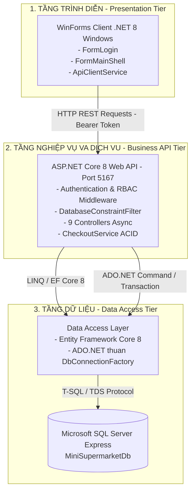
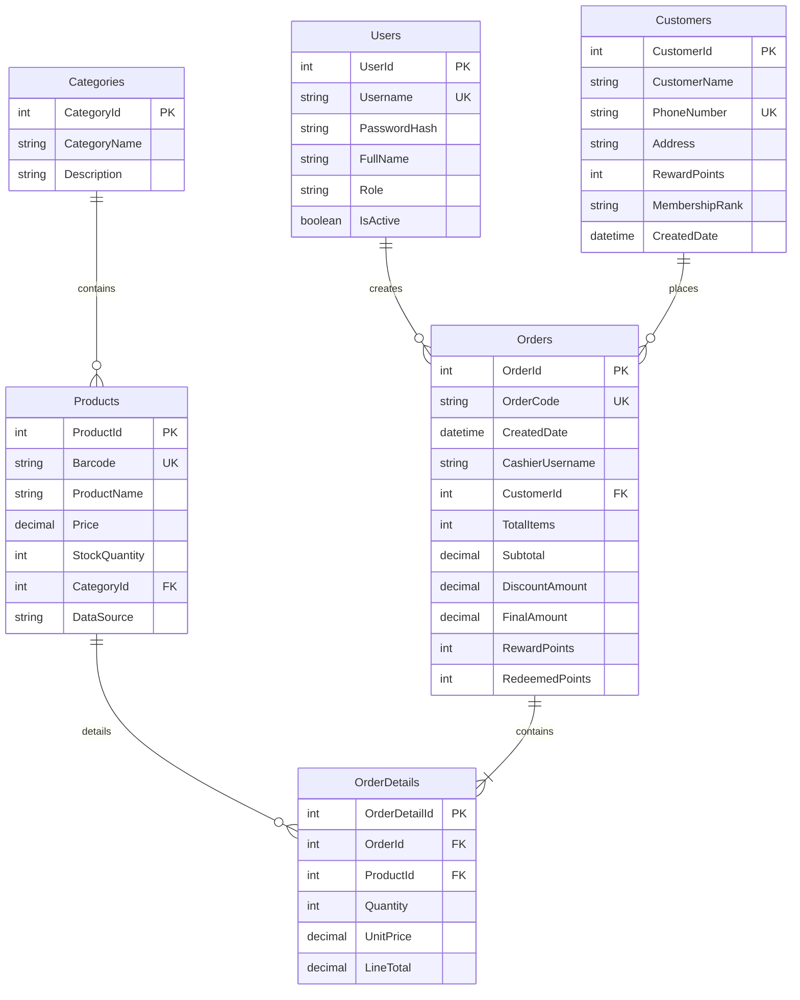
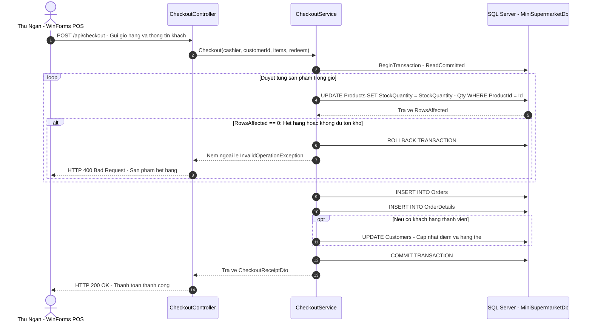

# Hệ thống Quản lý Bán lẻ Bách hóa Thiên Ân (MiniSupermarket)

> **Đồ án môn học:** Phát triển Phần mềm Ứng dụng & Kiến trúc Hệ thống .NET  
> **Sinh viên thực hiện:** Vương Nguyễn Trường Hưng · **MSSV:** 2124110111 · **Lớp:** CCQ2411D  
> **Giảng viên hướng dẫn:** ThS. Nguyễn Cao Thái  
> **Nền tảng công nghệ:** C# 12 / .NET 8 (LTS) · ASP.NET Core Web API · Windows Forms (.NET 8) · SQL Server Express  

---

## Mục lục
1. [Tổng quan đề tài](#1-tổng-quan-đề-tài)
2. [Kiến trúc hệ thống 3-Tier SOA](#2-kiến-trúc-hệ-thống-3-tier-soa)
3. [Công nghệ & Thư viện sử dụng](#3-công-nghệ--thư-viện-sử-dụng)
4. [Thiết kế Cơ sở dữ liệu (Database Design)](#4-thiết-kế-cơ-sở-dữ-liệu-database-design)
   - [4.1 Sơ đồ thực thể quan hệ (ERD - 6 Bảng)](#41-sơ-đồ-thực-thể-quan-hệ-erd---6-bảng)
   - [4.2 Từ điển dữ liệu chi tiết (Data Dictionary)](#42-từ-điển-dữ-liệu-chi-tiết-data-dictionary)
   - [4.3 Ràng buộc toàn vẹn & Concurrency Guard](#43-ràng-buộc-toàn-vẹn--concurrency-guard)
5. [Thiết kế Giao dịch POS nguyên tử (ACID Transaction)](#5-thiết-kế-giao-dịch-pos-nguyên-tử-acid-transaction)
6. [Đặc tả 4 Stored Procedures trong SQL Server](#6-đặc-tả-4-stored-procedures-trong-sql-server)
7. [Bảng so sánh kỹ thuật: EF Core 8 vs. ADO.NET](#7-bảng-so-sánh-kỹ-thuật-ef-core-8-vs-adonet)
8. [Đặc tả Hợp đồng RESTful API](#8-đặc-tả-hợp-đồng-restful-api)
9. [Ma trận Phân quyền người dùng (RBAC Matrix)](#9-ma-trận-phân-quyền-người-dùng-rbac-matrix)
10. [Kiến trúc Giao diện WinForms Client](#10-kiến-trúc-giao-diện-winforms-client)
11. [Ma trận Kiểm thử Phần mềm (93 Test Cases)](#11-ma-trận-kiểm-thử-phần-mềm-93-test-cases)
12. [Cấu trúc Thư mục Giải pháp](#12-cấu-trúc-thư-mục-giải-pháp)
13. [Hướng dẫn Cài đặt & Khởi chạy](#13-hướng-dẫn-cài-đặt--khởi-chạy)
14. [Tài khoản Thử nghiệm & Dữ liệu Mẫu](#14-tài-khoản-thử-nghiệm--dữ-liệu-mẫu)
15. [Hướng dẫn Xử lý Sự cố (Troubleshooting & FAQ)](#15-hướng-dẫn-xử-lý-sự-cố-troubleshooting--faq)
16. [Thông tin Bản quyền & Tác giả](#16-thông-tin-bản-quyền--tác-giả)

---

## 1. Tổng quan đề tài

**Hệ thống Bán lẻ Bách hóa Thiên Ân** là một giải pháp quản lý bán lẻ và kiểm soát hàng tồn kho toàn diện theo mô hình kiến trúc dịch vụ **3-Tier SOA (Service-Oriented Architecture)**. 

### Các mục tiêu nghiệp vụ cốt lõi:
- **Xác thực phi tập trung & An toàn:** Triển khai cơ chế băm mật khẩu chuẩn quân sự **PBKDF2-SHA256** kết hợp chuỗi định danh **JSON Web Token (JWT)** không lưu trạng thái (Stateless).
- **Kiểm soát truy cập dựa trên vai trò (RBAC):** Phân định ranh giới chức năng rõ ràng giữa 3 nhóm người dùng: Quản trị viên (`Admin`), Nhân viên thu ngân (`Cashier`), và Thủ kho (`Warehouse`).
- **Xử lý Bán hàng Siêu tốc & Toàn vẹn ACID:** Quầy thu ngân quét mã vạch thực thi giao dịch nguyên tử thông qua `SqlTransaction`, cam kết không bán âm kho và tự động Rollback 100% nếu phát sinh sự cố.
- **Quản lý Hàng hóa & Phân trang Phía Máy chủ:** Quản lý 15 nhóm ngành hàng và 100 sản phẩm mã vạch chuẩn quốc gia, sử dụng LINQ Server-side Pagination tối ưu băng thông.
- **Chăm sóc Khách hàng Thân thiết:** Tự động tích lũy điểm thưởng theo tỷ lệ doanh số, tự động nâng/hạ hạng thẻ thành viên (Đồng, Bạc, Vàng, Kim Cương) và cho phép đổi điểm khấu trừ tiền mặt.
- **Phân tích Điều hành & Báo cáo Trực quan:** Khai thác dữ liệu bán lẻ qua 4 Stored Procedures tối ưu hóa, biểu diễn trực quan bằng thư viện biểu đồ cột `System.Windows.Forms.DataVisualization.Charting.Chart` và hỗ trợ xuất báo cáo file CSV chuẩn UTF-8 BOM.

---

## 2. Kiến trúc hệ thống 3-Tier SOA

Hệ thống được tổ chức thành 3 tầng độc lập, giao tiếp với nhau qua giao thức tiêu chuẩn mở HTTP/JSON:



---

## 3. Công nghệ & Thư viện sử dụng

| Tầng kiến trúc | Công nghệ / Thư viện | Phiên bản | Mục đích sử dụng |
|---|---|:---:|---|
| **Nền tảng chung** | .NET Runtime | 8.0 LTS | Nền tảng thực thi đa luồng, hỗ trợ C# 12 hiện đại |
| **Backend API** | ASP.NET Core Web API | 8.0 | Xây dựng RESTful API chuẩn hóa |
| | `Microsoft.AspNetCore.Authentication.JwtBearer` | 8.0 | Middleware giải mã và xác thực JWT Bearer Token |
| | `System.IdentityModel.Tokens.Jwt` | 8.0 | Đóng gói Claims, phát hành và ký số Token |
| | `Swashbuckle.AspNetCore` | 6.6.2 | Tự động sinh tài liệu Open API & giao diện Swagger UI |
| **Bảo mật** | `System.Security.Cryptography` | Built-in | Thuật toán PBKDF2-SHA256 (120.000 iterations, 16-byte salt) |
| **Truy xuất dữ liệu** | `Microsoft.EntityFrameworkCore` | 8.0 | ORM quản trị quan hệ thực thể, Code-First Migrations |
| | `Microsoft.EntityFrameworkCore.SqlServer` | 8.0 | SQL Server Provider cho EF Core |
| | `Microsoft.Data.SqlClient` | 5.2.2 | Driver ADO.NET thuần hiệu năng cao cho giao dịch POS |
| **Frontend Client** | Windows Forms | .NET 8 | Giao diện đồ họa máy trạm desktop, hỗ trợ High-DPI |
| | `System.Windows.Forms.DataVisualization` | 1.0 | Vẽ biểu đồ cột doanh thu ca bán trực quan |
| | `System.Net.Http.Json` | 8.0 | Serialization / Deserialization dữ liệu JSON bất đồng bộ |
| **Kiểm thử** | `xUnit` | 2.5.3 | Khung kiểm thử đơn vị & kiểm thử tích hợp chuẩn công nghiệp |
| | `Microsoft.EntityFrameworkCore.InMemory` | 8.0 | Cơ sở dữ liệu giả lập trong RAM cho kiểm thử Controller |
| | `Microsoft.Data.Sqlite` | 8.0 | SQLite In-Memory mô phỏng giao thức SQL Server cho kiểm thử hồi quy |

---

## 4. Thiết kế Cơ sở dữ liệu (Database Design)

### 4.1 Sơ đồ thực thể quan hệ (ERD - 6 Bảng)



---

### 4.2 Từ điển dữ liệu chi tiết (Data Dictionary)

#### Bảng 1: `Categories` (Nhóm ngành hàng)
| Tên cột | Kiểu dữ liệu | Khóa | Nullable | Mô tả nghiệp vụ |
|---|---|:---:|:---:|---|
| `CategoryId` | `INT` | PK | NO | Mã định danh tự tăng duy nhất cho nhóm hàng |
| `CategoryName` | `NVARCHAR(100)` | | NO | Tên danh mục (ví dụ: Bánh kẹo & Đồ ăn vặt, Nước giải khát & Trà) |
| `Description` | `NVARCHAR(255)` | | YES | Mô tả đặc tính hoặc ghi chú chi tiết về nhóm ngành |

#### Bảng 2: `Products` (Hàng hóa & Tồn kho)
| Tên cột | Kiểu dữ liệu | Khóa | Nullable | Mô tả nghiệp vụ |
|---|---|:---:|:---:|---|
| `ProductId` | `INT` | PK | NO | Mã sản phẩm nội bộ tự tăng |
| `Barcode` | `NVARCHAR(50)` | UK | NO | Mã vạch chuẩn EAN-13 hoặc Code-128 duy nhất |
| `ProductName` | `NVARCHAR(150)` | | NO | Tên sản phẩm hiển thị trên hóa đơn và quầy POS |
| `Price` | `DECIMAL(18,2)` | | NO | Đơn giá bán lẻ niêm yết (VND) |
| `StockQuantity` | `INT` | | NO | Số lượng tồn kho thực tế; ràng buộc không được nhỏ hơn 0 |
| `CategoryId` | `INT` | FK | NO | Khóa ngoại tham chiếu đến bảng `Categories(CategoryId)` |
| `DataSource` | `NVARCHAR(100)` | | YES | Xuất xứ nguồn hàng (Kho tổng Thiên Ân, Nhập trực tiếp...) |

#### Bảng 3: `Users` (Nhân sự & Phân quyền)
| Tên cột | Kiểu dữ liệu | Khóa | Nullable | Mô tả nghiệp vụ |
|---|---|:---:|:---:|---|
| `UserId` | `INT` | PK | NO | Mã nhân viên tự tăng |
| `Username` | `NVARCHAR(50)` | UK | NO | Tài khoản đăng nhập hệ thống duy nhất |
| `PasswordHash` | `NVARCHAR(255)` | | NO | Chuỗi mã hóa dạng `PBKDF2$<iterations>$<salt>$<hash>` |
| `FullName` | `NVARCHAR(100)` | | NO | Họ và tên đầy đủ hiển thị trên giao diện và hóa đơn |
| `Role` | `NVARCHAR(20)` | | NO | Vai trò hệ thống: `Admin`, `Cashier`, hoặc `Warehouse` |
| `IsActive` | `BIT` | | NO | Cờ trạng thái: `1` = Hoạt động, `0` = Khóa tài khoản |

#### Bảng 4: `Customers` (Khách hàng & Điểm thưởng)
| Tên cột | Kiểu dữ liệu | Khóa | Nullable | Mô tả nghiệp vụ |
|---|---|:---:|:---:|---|
| `CustomerId` | `INT` | PK | NO | Mã khách hàng thành viên tự tăng |
| `CustomerName` | `NVARCHAR(100)` | | NO | Họ tên đầy đủ của khách hàng |
| `PhoneNumber` | `NVARCHAR(20)` | UK | NO | Số điện thoại dùng tra cứu nhanh tại quầy thu ngân |
| `Address` | `NVARCHAR(255)` | | YES | Địa chỉ liên hệ của khách hàng |
| `RewardPoints` | `INT` | | NO | Điểm tích lũy khả dụng (Cứ 10.000đ mua hàng = +1 điểm) |
| `MembershipRank` | `NVARCHAR(20)` | | NO | Hạng hội viên: `Đồng` (<50đ), `Bạc` (50-199đ), `Vàng` (200-499đ), `Kim Cương` (>=500đ) |
| `CreatedDate` | `DATETIME2` | | NO | Thời điểm gia nhập hệ thống thẻ thành viên |

#### Bảng 5: `Orders` (Hóa đơn bán hàng)
| Tên cột | Kiểu dữ liệu | Khóa | Nullable | Mô tả nghiệp vụ |
|---|---|:---:|:---:|---|
| `OrderId` | `INT` | PK | NO | Khóa chính hóa đơn tự tăng |
| `OrderCode` | `NVARCHAR(50)` | UK | NO | Mã hóa đơn định dạng `HDyyyyMMddHHmmssfff` |
| `CreatedDate` | `DATETIME2` | | NO | Thời điểm xuất vé thanh toán |
| `CashierUsername` | `NVARCHAR(50)` | | NO | Tài khoản thu ngân lập hóa đơn |
| `CustomerId` | `INT` | FK | YES | Khóa ngoại tham chiếu `Customers` (Null nếu khách vãng lai) |
| `TotalItems` | `INT` | | NO | Tổng số lượng món hàng trong giỏ |
| `Subtotal` | `DECIMAL(18,2)` | | NO | Tổng tiền hàng ban đầu |
| `DiscountAmount` | `DECIMAL(18,2)` | | NO | Số tiền được giảm do đổi điểm thưởng |
| `FinalAmount` | `DECIMAL(18,2)` | | NO | Thực thu thanh toán (Subtotal - DiscountAmount) |
| `RewardPoints` | `INT` | | NO | Số điểm thưởng tặng thêm từ đơn hàng này |
| `RedeemedPoints` | `INT` | | NO | Số điểm thưởng đã trừ trong đơn hàng này |

#### Bảng 6: `OrderDetails` (Chi tiết dòng hóa đơn)
| Tên cột | Kiểu dữ liệu | Khóa | Nullable | Mô tả nghiệp vụ |
|---|---|:---:|:---:|---|
| `OrderDetailId` | `INT` | PK | NO | Mã dòng chi tiết tự tăng |
| `OrderId` | `INT` | FK | NO | Khóa ngoại tham chiếu đến `Orders(OrderId)` (Cascade Delete) |
| `ProductId` | `INT` | FK | NO | Khóa ngoại tham chiếu đến `Products(ProductId)` (Restrict Delete) |
| `Quantity` | `INT` | | NO | Số lượng mua của sản phẩm này |
| `UnitPrice` | `DECIMAL(18,2)` | | NO | Đơn giá gốc chốt tại thời điểm thanh toán |
| `LineTotal` | `DECIMAL(18,2)` | | NO | Thành tiền của dòng hàng (`Quantity * UnitPrice`) |

---

### 4.3 Ràng buộc toàn vẹn & Concurrency Guard

1. **Bảo toàn lịch sử hóa đơn:** Ràng buộc khóa ngoại giữa `OrderDetails` và `Products` sử dụng `ON DELETE NO ACTION` (Restrict). Nếu sản phẩm đã từng phát sinh giao dịch trong lịch sử, API sẽ chặn thao tác xóa và trả về HTTP `409 Conflict`.
2. **Bảo vệ đồng thời khi sửa sản phẩm (Optimistic Concurrency):** DTO cập nhật sản phẩm bắt buộc truyền `ExpectedStockQuantity`. Nếu tồn kho trong CSDL đã bị quầy POS bán mất trong lúc thủ kho đang mở form chỉnh sửa, hệ thống sẽ phát hiện sai lệch và từ chối lưu thay đổi.
3. **Bộ lọc DatabaseConstraintFilter:** Middleware `IExceptionFilter` tự động chuyển đổi các lỗi vi phạm ràng buộc SQL Server (Lỗi số `2601` - Trùng khóa duy nhất, `2627` - Vi phạm Unique Constraint, `547` - Vi phạm Khóa ngoại) thành thông điệp tiếng Việt thân thiện thay vì làm sập ứng dụng.

---

## 5. Thiết kế Giao dịch POS nguyên tử (ACID Transaction)

Quá trình thanh toán tại quầy POS là phân hệ nhạy cảm nhất về tài chính. Hệ thống không sử dụng lưu tự động của ORM mà kiểm soát trực tiếp bằng `SqlTransaction` cấp độ cơ sở dữ liệu:



---

## 6. Đặc tả 4 Stored Procedures trong SQL Server

Cơ sở dữ liệu tích hợp sẵn 4 Stored Procedures nhằm tối ưu hóa các tác vụ tính toán thống kê phức tạp phía máy chủ:

### 1. `sp_GetRevenueByCashier`
- **Mục đích:** Thống kê tổng doanh thu, số lượng đơn hàng và tổng điểm thưởng đã tích lũy phân nhóm theo từng nhân viên thu ngân.
- **Mã T-SQL:**
```sql
CREATE PROCEDURE dbo.sp_GetRevenueByCashier
AS
BEGIN
    SET NOCOUNT ON;
    SELECT CashierUsername,
           COUNT(OrderId) AS TotalOrders,
           SUM(FinalAmount) AS TotalRevenue,
           SUM(RewardPoints) AS TotalPointsAwarded
    FROM Orders
    GROUP BY CashierUsername
    ORDER BY TotalRevenue DESC;
END
```

### 2. `sp_GetTop5SellingProducts`
- **Mục đích:** Tìm ra 5 mặt hàng có sản lượng tiêu thụ lớn nhất toàn hệ thống, phục vụ lập kế hoạch nhập kho.
- **Mã T-SQL:**
```sql
CREATE PROCEDURE dbo.sp_GetTop5SellingProducts
AS
BEGIN
    SET NOCOUNT ON;
    SELECT TOP 5 
           p.ProductId,
           p.Barcode,
           p.ProductName,
           p.Price,
           SUM(od.Quantity) AS TotalSoldQuantity,
           SUM(od.LineTotal) AS TotalSalesAmount
    FROM OrderDetails od
    INNER JOIN Products p ON od.ProductId = p.ProductId
    GROUP BY p.ProductId, p.Barcode, p.ProductName, p.Price
    ORDER BY TotalSoldQuantity DESC, TotalSalesAmount DESC;
END
```

### 3. `sp_GetRevenueByDateRange`
- **Tham số:** `@FromDate DATETIME`, `@ToDate DATETIME`
- **Mục đích:** Tổng hợp doanh thu kinh doanh theo từng ngày trong một khoảng thời gian linh hoạt.
- **Mã T-SQL:**
```sql
CREATE PROCEDURE dbo.sp_GetRevenueByDateRange
    @FromDate DATETIME,
    @ToDate DATETIME
AS
BEGIN
    SET NOCOUNT ON;
    SELECT CAST(CreatedDate AS DATE) AS OrderDate,
           COUNT(OrderId) AS TotalOrders,
           SUM(FinalAmount) AS DailyRevenue
    FROM Orders
    WHERE CreatedDate >= @FromDate AND CreatedDate <= @ToDate
    GROUP BY CAST(CreatedDate AS DATE)
    ORDER BY OrderDate ASC;
END
```

### 4. `sp_GetDailyRevenue`
- **Mục đích:** Cung cấp chuỗi dữ liệu phục vụ dựng biểu đồ cột trực quan trong màn hình Quản trị Báo cáo doanh thu.

---

## 7. Bảng so sánh kỹ thuật: EF Core 8 vs. ADO.NET

Dự án áp dụng mô hình phối hợp **Hybrid Data Access** tinh vi, lựa chọn đúng công nghệ cho từng bài toán nghiệp vụ cụ thể:

| Tiêu chí kỹ thuật | Entity Framework Core 8 | ADO.NET thuần (`Microsoft.Data.SqlClient`) |
|---|---|---|
| **Vị trí ứng dụng** | `ProductsController`, `CategoriesController`, `UsersController`, `CustomersController` | `AdoProductController`, `CheckoutService` (POS), `ReportsController` |
| **Chế độ kết nối** | Quản lý vòng đời DbContext thông qua Dependency Injection | Khởi tạo qua `IDbConnectionFactory`, dùng `using (connection)` đóng mở chặt chẽ |
| **Phân trang dữ liệu** | LINQ `.Skip((page-1)*size).Take(size)` sinh câu lệnh `OFFSET ... FETCH NEXT` | Sử dụng SQL Parameter hóa `@MinStock`, `@Barcode` |
| **Quét mã vạch POS** | Không sử dụng (tránh overhead sinh truy vấn và change tracking) | `SqlDataReader` (Connected Mode, Forward-only) đọc trực tiếp byte dữ liệu cực nhanh |
| **Bộ đệm Offline** | Không phù hợp | Sử dụng `DataTable` + `SqlDataAdapter` (Disconnected Mode) ngắt kết nối ngay sau khi nạp RAM |
| **Giao dịch tài chính** | Thường dùng `SaveChanges()` dễ xung đột | Dùng `SqlTransaction` tường minh với mệnh đề khóa `AND StockQuantity >= @Qty` |
| **Tối ưu Stored Proc** | Cần ánh xạ phức tạp qua `FromSqlRaw` | Gọi trực tiếp qua `command.CommandType = CommandType.StoredProcedure` |

---

## 8. Đặc tả Hợp đồng RESTful API

Tất cả các endpoint (trừ đăng nhập) đều yêu cầu Header:  
`Authorization: Bearer <JWT_TOKEN>`

### 8.1 Nhóm Xác thực (`/api/auth`)
- **POST `/api/auth/login`**: Đăng nhập hệ thống
  - **Request Body:**
    ```json
    { "username": "admin", "password": "admin@123" }
    ```
  - **Response `200 OK`:**
    ```json
    {
      "success": true,
      "token": "eyJhbGciOiJIUzI1NiIsInR5cCI6...",
      "role": "Admin",
      "username": "admin",
      "fullName": "Vương Nguyễn Trường Hưng"
    }
    ```
  - **Mã lỗi:** `401 Unauthorized` (Sai mật khẩu hoặc tài khoản bị khóa).

### 8.2 Nhóm Sản phẩm (`/api/products` & `/api/ado-products`)
- **GET `/api/products/paged?keyword=...&categoryId=...&pageNumber=1&pageSize=10`**: Phân trang máy chủ
- **GET `/api/ado-products/barcode/{barcode}`**: Tra cứu nhanh bằng ADO.NET DataReader
- **GET `/api/ado-products/filter-stock?minStock=50`**: Lọc tồn kho dưới mức an toàn
- **GET `/api/ado-products/count-by-category`**: Thống kê số lượng SP từng danh mục bằng DataTable
- **POST `/api/products`**: Thêm mới sản phẩm (`Admin, Warehouse`) -> Trả về `201 Created`
- **PUT `/api/products/{id}`**: Cập nhật sản phẩm có chống xung đột (`ExpectedStockQuantity`) -> Trả về `204 NoContent`
- **DELETE `/api/products/{id}`**: Xóa sản phẩm chưa có đơn hàng -> Trả về `204 NoContent` (nếu đã có đơn hàng -> `409 Conflict`)

### 8.3 Nhóm Bán hàng POS (`/api/checkout`)
- **POST `/api/checkout`**: Thực thi giao dịch POS ACID
  - **Request Body:**
    ```json
    {
      "cashierUsername": "cashier01",
      "customerId": 1,
      "customerPhone": "0901234567",
      "items": [
        { "productId": 1, "quantity": 2, "unitPrice": 12500 }
      ],
      "redeemPoints": 50
    }
    ```
  - **Response `200 OK`:**
    ```json
    {
      "success": true,
      "orderId": 17,
      "orderCode": "HD20261105172236001",
      "totalItems": 2,
      "subtotal": 25000,
      "discountAmount": 50000,
      "finalAmount": 0,
      "rewardPointsAdded": 0,
      "redeemedPoints": 50,
      "cashier": "cashier01",
      "customer": "Nguyễn Văn An",
      "timestamp": "2026-11-05T17:22:36"
    }
    ```
- **DELETE `/api/checkout/cancel/{orderId}`**: Hủy đơn hàng và hoàn trả tồn kho (`Admin`)

### 8.4 Nhóm Báo cáo Doanh thu (`/api/reports`)
- **GET `/api/reports/quick`**: 4 chỉ số KPI ca bán
- **GET `/api/reports/revenue-by-cashier`**: Doanh thu theo thu ngân (gọi Stored Procedure)
- **GET `/api/reports/top-selling-products`**: Top 5 sản phẩm bán chạy (gọi Stored Procedure)
- **GET `/api/reports/dashboard-summary?fromDate=...&toDate=...`**: Dữ liệu biểu đồ cột và chuỗi thời gian

---

## 9. Ma trận Phân quyền người dùng (RBAC Matrix)

| Chức năng hệ thống | Endpoint API | Màn hình WinForms | Admin | Cashier | Warehouse | Khách vãng lai |
|---|---|---|:---:|:---:|:---:|:---:|
| Đăng nhập hệ thống | `POST /api/auth/login` | `FormLogin` | ✅ | ✅ | ✅ | ❌ |
| Bán hàng POS quét mã vạch | `POST /api/checkout` | `FormPOS` | ✅ | ✅ | ❌ | ❌ |
| Đổi điểm thưởng thành viên | `POST /api/checkout` | `FormPOS` | ✅ | ✅ | ❌ | ❌ |
| Xem danh mục nhóm hàng | `GET /api/categories` | `FormCategoryManagement` | ✅ | ✅ | ✅ | ❌ |
| Thêm / Sửa / Xóa nhóm hàng | `POST/PUT/DELETE /api/categories` | `FormCategoryManagement` | ✅ | ❌ | ✅ | ❌ |
| Xem & lọc danh sách sản phẩm | `GET /api/products/paged` | `FormProductManagement` | ✅ | ✅ | ✅ | ❌ |
| Thêm / Sửa / Cập nhật tồn kho | `POST/PUT /api/products` | `FormProductManagement` | ✅ | ❌ | ✅ | ❌ |
| Xóa sản phẩm chưa bán | `DELETE /api/products/{id}` | `FormProductManagement` | ✅ | ❌ | ✅ | ❌ |
| Xuất danh sách SP ra file CSV | *(Xử lý Client)* | `FormProductManagement` | ✅ | ❌ | ✅ | ❌ |
| Quản lý thông tin khách hàng | `GET/POST/PUT /api/customers` | `FormCustomerManagement` | ✅ | ✅ | ❌ | ❌ |
| Xóa khách hàng | `DELETE /api/customers/{id}` | `FormCustomerManagement` | ✅ | ❌ | ❌ | ❌ |
| Xem báo cáo doanh thu & KPI | `GET /api/reports/*` | `FormQuickReport` | ✅ | ❌ | ❌ | ❌ |
| Xem biểu đồ cột doanh thu | `GET /api/reports/*` | `FormQuickReport` | ✅ | ❌ | ❌ | ❌ |
| Hủy hóa đơn & hoàn tồn kho | `DELETE /api/checkout/cancel/{id}` | `FormMainShell` | ✅ | ❌ | ❌ | ❌ |
| Quản trị tài khoản & Khóa thẻ | `GET/POST/PUT /api/users` | `FormUserManagement` | ✅ | ❌ | ❌ | ❌ |

---

## 10. Kiến trúc Giao diện WinForms Client

Ứng dụng máy trạm Windows Forms được thiết kế hiện đại, tuân thủ các quy chuẩn công nghiệp:
- **Single-Form Shell Workspace (`FormMainShell`):** Giao diện khung điều khiển trung tâm với thanh Sidebar cố định bên trái, khu vực `panelMainContent` ở giữa nhúng động các Form con (`childForm.TopLevel = false; childForm.Dock = DockStyle.Fill;`).
- **Giao diện Responsive linh hoạt (Anchors & Fill):** Khắc phục triệt để tình trạng form bị co cụm khi phóng to cửa sổ trên các màn hình Full HD / 2K / 4K. Khung danh mục và bảng dữ liệu được gắn neo 4 chiều (`Top | Bottom | Left | Right`) kết hợp thuộc tính `AutoSizeColumnsMode = DataGridViewAutoSizeColumnsMode.Fill`.
- **Thư viện Biểu đồ Thống kê:** Phân hệ báo cáo tích hợp trực tiếp `System.Windows.Forms.DataVisualization.Charting.Chart`, vẽ biểu đồ cột doanh thu theo chu kỳ ngày rõ ràng, chuyên nghiệp.
- **Xuất CSV chuẩn Quốc tế:** Module `CsvExportService` xuất dữ liệu bảng ra file `.csv` có gắn ký tự định danh chuẩn **UTF-8 BOM (`0xEF, 0xBB, 0xBF`)**, đảm bảo mở trực tiếp trên Microsoft Excel hiển thị trọn vẹn dấu tiếng Việt mà không bị lỗi font chữ.

---

## 11. Ma trận Kiểm thử Phần mềm (93 Test Cases)

Hệ thống được trang bị bộ kiểm thử tự động toàn diện gồm **93 Test Cases** sử dụng xUnit:

```text
========================================================================================
   TỔNG HỢP KIỂM THỬ: 93/93 TEST CASES VƯỢT QUA 100% (Thời gian chạy: ~2.4 giây)
========================================================================================
```

| STT | Lớp kiểm thử (Test Class) | Số TC | Nội dung kiểm thử chi tiết |
|:---:|---|:---:|---|
| 1 | `AsyncControllerContractTests` | 1 | Kiểm tra Reflection đảm bảo 100% HTTP Actions đều trả về kiểu `Task` |
| 2 | `AuthControllerTests` | 4 | Đăng nhập Admin, Cashier, Warehouse, kiểm tra tính hợp lệ của JWT Claims |
| 3 | `ProductsControllerTests` | 13 | Phân trang LINQ, tìm kiếm từ khóa, validate mã vạch chữ số, bảo vệ lịch sử hóa đơn |
| 4 | `CategoriesControllerTests` | 9 | CRUD danh mục, tìm kiếm, phân quyền truy cập Dashboard theo vai trò |
| 5 | `CustomersControllerTests` | 8 | CRUD khách hàng, tìm kiếm, sắp xếp theo điểm tích lũy giảm dần |
| 6 | `UsersControllerTests` | 6 | Quản lý người dùng, từ chối tài khoản trùng, mã hóa mật khẩu khi tạo mới |
| 7 | `OrdersControllerTests` | 4 | Xem danh sách hóa đơn, xem chi tiết dòng hóa đơn, phân trang đơn hàng |
| 8 | `ReportsControllerTests` | 1 | Báo cáo KPI tổng hợp ca bán chạy trên SQLite in-memory |
| 9 | `Buoi5AdoNetTests` | 10 | Kiểm tra ADO.NET Barcode, lọc tồn kho, đếm nhóm hàng, thực thi Stored Procedures |
| 10 | `CheckoutRegressionTests` | 25 | Kiểm thử giao dịch ACID: Giả lập lỗi giữa chừng, kiểm tra Rollback, hoàn điểm |
| 11 | `ZeroStockIntegrationTests` | 13 | Kiểm thử tích hợp sản phẩm biên (ID 21–100, tồn kho = 0): Chống bán âm kho |
| 12 | `RubricSafetyTests` | 4 | Kiểm tra các quy tắc nghiệp vụ khắt khe: Thu ngân không được tự ý can thiệp điểm |

---

## 12. Cấu trúc Thư mục Giải pháp

```text
c:\HeThongBanLeThienAn\
├── HeThongBanLeThienAn.sln                     # File Solution điều phối giải pháp
├── README.md                                   # Tài liệu kỹ thuật chi tiết của đồ án
│
├── HeThongBanLeThienAn.API/                   # DỰ ÁN 1: ASP.NET Core 8 Web API
│   ├── Controllers/                            # 9 API Controllers bất đồng bộ
│   │   ├── AdoProductController.cs             # Tra cứu Barcode & DataTable ADO.NET
│   │   ├── AuthController.cs                   # Đăng nhập & cấp phát JWT Token
│   │   ├── CategoriesController.cs             # Quản lý Nhóm ngành hàng
│   │   ├── CheckoutController.cs               # Quầy thu ngân POS (ACID)
│   │   ├── CustomersController.cs              # Quản lý Khách hàng & Điểm
│   │   ├── OrdersController.cs                 # Lịch sử đơn hàng
│   │   ├── ProductsController.cs               # Quản lý 100 sản phẩm mã vạch
│   │   ├── ReportsController.cs                # Báo cáo Stored Procedures
│   │   └── UsersController.cs                  # Quản trị tài khoản nhân viên
│   ├── Data/                                   # Tầng truy xuất CSDL
│   │   ├── CheckoutService.cs                  # Logic giao dịch POS bọc SqlTransaction
│   │   ├── DatabaseConstraintFilter.cs         # Bắt lỗi ràng buộc CSDL & Concurrency
│   │   ├── DbConnectionFactory.cs              # Factory cấp phát kết nối SQL Server/SQLite
│   │   └── SupermarketDbContext.cs             # DbContext, Fluent API & Data Seeding
│   ├── Migrations/                             # EF Core Code-First Migrations
│   ├── Models/                                 # Entity Models & Data Transfer Objects (DTO)
│   ├── Security/                               # Lớp mã hóa mật khẩu PBKDF2 an toàn
│   └── Program.cs                              # Cấu hình DI, CORS, JWT & Swagger
│
├── HeThongBanLeThienAn.WinForms/              # DỰ ÁN 2: Windows Forms Client (.NET 8)
│   ├── ApiClientService.cs                     # Wrapper gửi HTTP Request đính kèm Bearer Token
│   ├── CsvExportService.cs                     # Dịch vụ xuất bảng dữ liệu ra CSV UTF-8 BOM
│   ├── SessionManager.cs                       # Quản lý thông tin phiên làm việc người dùng
│   ├── FormLogin.cs                            # Màn hình đăng nhập tài khoản
│   ├── FormMainShell.cs                        # Giao diện khung điều khiển chính (Sidebar)
│   ├── FormPOS.cs                              # Giao diện bán hàng quét mã vạch
│   ├── FormProductManagement.cs                # Giao diện quản lý sản phẩm (Responsive)
│   ├── FormCategoryManagement.cs               # Giao diện quản lý danh mục (Responsive)
│   ├── FormCustomerManagement.cs               # Giao diện quản lý khách hàng (Responsive)
│   ├── FormUserManagement.cs                   # Giao diện quản trị tài khoản
│   └── FormQuickReport.cs                      # Giao diện báo cáo & Biểu đồ Charting
│
└── HeThongBanLeThienAn.Tests/                  # DỰ ÁN 3: Bộ Kiểm thử xUnit (93 Test Cases)
    ├── AsyncControllerContractTests.cs         # Test hợp đồng bất đồng bộ của Controller
    ├── AuthControllerTests.cs                  # Test xác thực & cấp phát JWT
    ├── Buoi5AdoNetTests.cs                     # Test nghiệp vụ ADO.NET & Stored Procedures
    ├── CheckoutRegressionTests.cs              # Test hồi quy giao thức ACID & Rollback
    ├── ProductsControllerTests.cs              # Test CRUD & Phân trang sản phẩm
    ├── ZeroStockIntegrationTests.cs            # Test dữ liệu biên sản phẩm hết hàng
    └── RubricSafetyTests.cs                    # Test các quy tắc bảo mật dữ liệu
```

---

## 13. Hướng dẫn Cài đặt & Khởi chạy

### Bước 1: Chuẩn bị môi trường
- Cài đặt **.NET 8.0 SDK** (phiên bản 8.0.400 trở lên).
- Cài đặt **Microsoft SQL Server Express** (Instance mặc định: `localhost\SQLEXPRESS`).

### Bước 2: Cập nhật Cơ sở dữ liệu
Mở terminal tại thư mục gốc của giải pháp và thực thi:
```powershell
dotnet ef database update --context SqlServerSupermarketDbContext --project HeThongBanLeThienAn.API --startup-project HeThongBanLeThienAn.API
```
*Lệnh trên sẽ tự động tạo database `MiniSupermarketDb`, khởi tạo cấu trúc 6 bảng, nạp 100 sản phẩm mẫu và 15 tài khoản nhân viên.*

### Bước 3: Khởi chạy Backend Web API
```powershell
dotnet run --project .\HeThongBanLeThienAn.API\HeThongBanLeThienAn.API.csproj --launch-profile "http"
```
- API lắng nghe tại: `http://localhost:5167`
- Tài liệu kiểm thử Swagger UI: `http://localhost:5167/swagger`

### Bước 4: Khởi chạy Giao diện WinForms
Mở một cửa sổ terminal mới và chạy:
```powershell
dotnet run --project .\HeThongBanLeThienAn.WinForms\HeThongBanLeThienAn.WinForms.csproj
```
*(Hoặc nhấp đúp trực tiếp vào file `.exe` tại: `HeThongBanLeThienAn.WinForms\bin\Debug\net8.0-windows\HeThongBanLeThienAn.WinForms.exe`)*

### Bước 5: Chạy toàn bộ 93 bài kiểm thử
```powershell
dotnet test .\HeThongBanLeThienAn.Tests\HeThongBanLeThienAn.Tests.csproj --logger "console;verbosity=normal"
```

---

## 14. Tài khoản Thử nghiệm & Dữ liệu Mẫu

Dữ liệu nạp sẵn trong hệ thống (Seed Data) sẵn sàng cho buổi bảo vệ đồ án:

| Vai trò | Tên đăng nhập | Mật khẩu | Quyền hạn kiểm thử |
|---|---|---|---|
| **Quản trị viên (Admin)** | `admin` | `admin@123` | Toàn quyền quản trị hệ thống, quản lý tài khoản, xem biểu đồ tài chính |
| **Thu ngân 1** | `cashier01` | `cashier@123` | Bán hàng POS, quét mã vạch, tích điểm và đổi điểm |
| **Thu ngân 2 - 9** | `cashier02` đến `cashier09` | `cashier@123` | Phục vụ kiểm thử tải đa thu ngân |
| **Thủ kho 1 - 3** | `warehouse01` đến `warehouse03` | `wh@123` | Quản lý danh mục, chỉnh sửa thông tin sản phẩm và cập nhật tồn kho |
| **Tài khoản bị khóa** | `staff_lock` | `cashier@123` | Tài khoản nhân viên đã nghỉ việc (`IsActive = 0`) dùng kiểm tra từ chối đăng nhập |

### Lưu ý quan trọng khi Demo Bán hàng & Báo cáo:
- **Dải mã vạch có sẵn hàng tồn kho:** Sử dụng các mã vạch từ **`893456789001` đến `893456789020`** (Sản phẩm ID 1–20 có tồn kho dương lớn phục vụ demo quầy thu ngân).
- **Dải mã vạch kiểm thử hết hàng (Zero Stock):** Sử dụng các mã vạch từ **`893456789021` đến `893456789100`** (`StockQuantity = 0`). Quét vào POS sẽ kích hoạt cơ chế từ chối thanh toán và Rollback an toàn.
- **Xem biểu đồ doanh thu:** Dữ liệu bán hàng mẫu phát sinh từ ngày **`01/10/2026` đến `07/10/2026`**. Khi vào màn hình Báo cáo, chỉnh ô *"Từ ngày"* thành `01/10/2026` để hiển thị biểu đồ đầy đủ nhất.

---

## 15. Hướng dẫn Xử lý Sự cố (Troubleshooting & FAQ)

### Q1: WinForms báo lỗi "Lỗi kết nối đến Server"?
- **Nguyên nhân:** Backend Web API chưa được khởi chạy hoặc bị tắt tiến trình.
- **Cách xử lý:** Mở terminal gõ lệnh chạy API: `dotnet run --project .\HeThongBanLeThienAn.API\HeThongBanLeThienAn.API.csproj --launch-profile "http"` và kiểm tra Swagger tại `http://localhost:5167/swagger`.

### Q2: Máy tính giảng viên dùng instance SQL Server khác (không phải SQLEXPRESS)?
- **Cách xử lý:** Mở file [`appsettings.json`](file:///c:/HeThongBanLeThienAn/HeThongBanLeThienAn.API/appsettings.json) trong dự án API, điều chỉnh chuỗi kết nối:
  ```json
  "DefaultConnection": "Server=.;Database=MiniSupermarketDb;Trusted_Connection=True;TrustServerCertificate=True"
  ```
  *(Thay `localhost\SQLEXPRESS` bằng `.` hoặc `(local)` tương ứng với máy chấm).*

### Q3: Mật khẩu người dùng trong CSDL xem như thế nào?
- **Giải thích:** Hệ thống tuân thủ tiêu chuẩn an toàn thông tin, không lưu mật khẩu dạng văn bản thô (Plaintext). Mọi mật khẩu đều được băm một chiều với muối ngẫu nhiên bằng PBKDF2-SHA256. Để đăng nhập, sử dụng các mật khẩu mẫu đã liệt kê ở Mục 14.

---

## 16. Thông tin Bản quyền & Tác giả

Đồ án được nghiên cứu, thiết kế và phát triển độc lập phục vụ công tác đánh giá học phần chuyên ngành Công nghệ Phần mềm:
- **Sinh viên thực hiện:** Vương Nguyễn Trường Hưng
- **Mã số sinh viên:** 2124110111
- **Lớp:** CCQ2411D
- **Khoa:** Công nghệ Thông tin
- **Bản quyền:** © 2026 Vương Nguyễn Trường Hưng. Giữ toàn quyền phát triển cho mục đích học tập và nghiên cứu.
